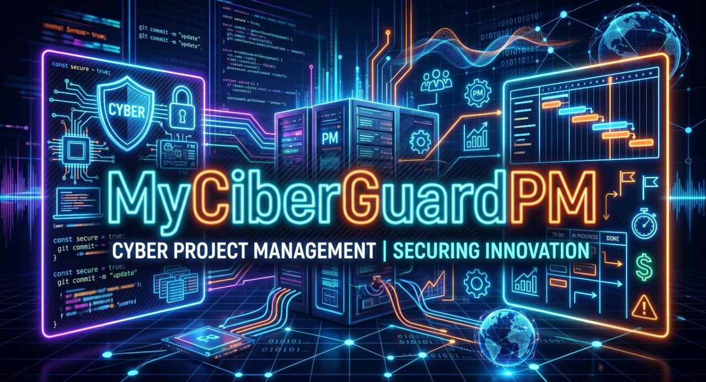

# MyCiberGuardPM

**MyCiberGuardPM** es el caso de estudio de Project Management del script **Network Monitor CLI** — una herramienta Bash para monitorizar tráfico de egress en servidores Linux y enviar alertas automáticas a Telegram.

Este repositorio contiene únicamente la documentación PM (contexto, requisitos, riesgos, roadmap…). El código fuente está en un repositorio separado: [LadyKernel/MyIronGuard — /network-monitor](https://github.com/LadyKernel/MyIronGuard/tree/main/network-monitor)

---

## El problema (The FinOps Problem)

En el entorno cloud actual (GCP, AWS, Azure), el tráfico de salida (*egress traffic*) es uno de los costes más variables e impredecibles para administradores de sistemas y desarrolladores independientes. Un pico inesperado —ataque, bucle mal gestionado o despliegue defectuoso— puede inflar la factura mensual en horas sin que el proveedor alerte en tiempo real.

**Network Monitor CLI** es una herramienta ligera instalable con un solo comando en cualquier servidor Linux. Monitoriza el tráfico de red, calcula el coste estimado de egress y envía alertas a Telegram únicamente cuando se superan los umbrales configurados — sin spam, sin agentes externos, sin coste adicional de infraestructura.

**Usuario objetivo:** Administradores de sistemas y desarrolladores que gestionan instancias VPS o cloud (GCP, DigitalOcean, AWS Free Tier) y necesitan visibilidad de costes sin la complejidad de herramientas como Datadog o Prometheus.

---

## Resumen ejecutivo

| | |
|---|---|
| **Problema** | Falta de visibilidad inmediata del tráfico de egress → coste oculto descubierto en factura |
| **Solución** | CLI ligera: monitorización en tiempo real + alertas Telegram sin spam |
| **Stack** | Bash · vnStat · jq · curl · API Telegram |
| **Arquitecturas** | VPS estándar (`/vps-estandar`) · Google Cloud (`/gcloud`) |
| **Licencia** | PolyForm Noncommercial License 1.0.0 |

---

## Documentación de gestión de proyecto (PM)

Este repositorio aplica un marco de Project Management completo sobre el desarrollo real del script, como hilo conductor del curso. Desde la definición del problema hasta el cierre con reflexión y lecciones aprendidas.

| # | Sección | Descripción |
|---|---------|-------------|
| 01 | [Contexto y Objetivo](./01-contexto-objetivo/README.md) | Por qué existe el proyecto, qué problema resuelve y qué define el éxito |
| 02 | [Alcance y Entregables](./02-alcance-entregables/README.md) | Qué está dentro del proyecto, qué está fuera y qué se produce |
| 03 | [Estructura de Trabajo](./03-estructura-trabajo/README.md) | WBS/EDT y cronograma por fases |
| 04 | [Stakeholders](./04-stakeholders/README.md) | Quién está implicado y qué rol tiene |
| 05 | [Matriz de Riesgos](./05-matriz-riesgos/README.md) | Riesgos identificados, probabilidad, impacto y plan de respuesta |
| 06 | [Requirements / PRD](./06-requirements-prd/README.md) | Épicas, historias de usuario y criterios de aceptación |
| 07 | [Roadmap y Métricas](./07-roadmap-metricas/README.md) | Evolución futura del producto y KPIs de éxito |
| 08 | [Uso Responsable de IA](./08-uso-responsable-ia/README.md) | Cómo se ha utilizado IA en este proyecto |
| 09 | [Lecciones Aprendidas](./09-lecciones-aprendidas/README.md) | Reflexión y mejoras futuras |

---

*Caso de estudio desarrollado por LadyKernel — Curso de Project Management, 2026*
